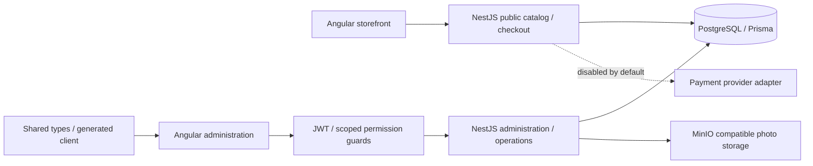

# Developer guide

## Start reading here

- `apps/website/src/app/core/services/fitment-data.service.ts`: data-access contract for vehicle and product selection. `http-fitment-data.service.ts` is the real transport; `app/demo/catalog.demo.ts` is only the static-demo implementation.
- `apps/website/src/app/core/services/cart.service.ts`: persists product identity and intent, normalizes legacy carts, clamps quantities and deliberately does not trust persisted prices.
- `apps/api/src/products/public-product.serializer.ts`: public catalog projection protects wholesale pricing and internal stock details.
- `apps/api/src/checkout/cart-quote.service.ts`: price and availability are read from authoritative server data. `order-state.ts` defines legal transitions and rejects repeated/illegal transitions.
- `apps/api/src/operations/`: workflow commands, reservation and stock movement logic. Read the adjacent domain tests alongside the services.
- `apps/api/src/auth/permission-evaluator.ts`: global and scoped grants are evaluated explicitly. A scoped wildcard does not become global authority.
- `apps/api/src/audit/` and `jobs/`: structured audit boundaries and guarded job infrastructure. Their existence does not mean every rollout is enabled.
- `apps/api/prisma/schema.prisma` and `migrations/`: relational model and evolution, including database-level grants and ownership boundaries.
- `packages/admin-api-client/src/runtime.ts`: callable client transport and structured API errors. `packages/shared/src/` carries shared contracts/classification helpers.

## Demo isolation

Angular's `demo` build configuration replaces only configuration/environment files. The storefront retains the real routes and components while swapping the data provider; the operations bundle enters the local simulation route. Both install terminal HTTP interceptors that never forward a request. No production API origin is configured in these builds.

`tools/stage-demos.mjs` copies browser-only output into `docs/` and rewrites original absolute media paths to relative paths. Local videos, photos and fonts are packaged with the demo. The normal build retains the server/API integration and its authentication behavior.

## Deliberate limits

Payment code is present for review, but public checkout is gated off. External fitment is mocked locally. Private operational artifacts are absent, so deployment-specific conformance suites cannot be reproduced from this package. The static operations UI is a simulation, not an authenticated management session. The full backend can be started with an isolated synthetic database to inspect actual HTTP behavior.
